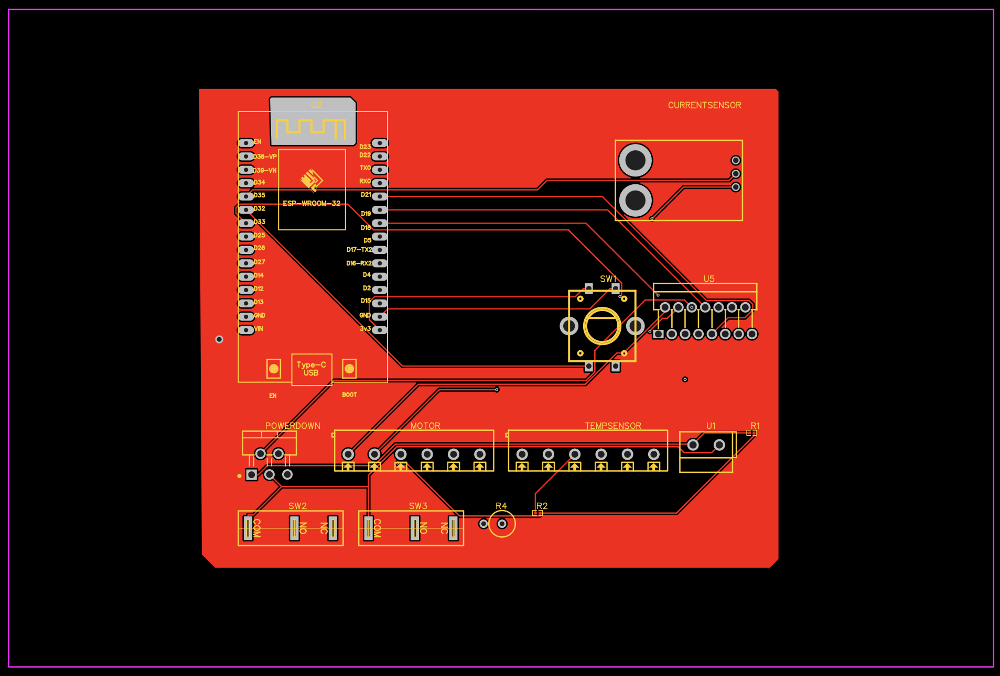

# 24V Intelligent Industrial Motor Controller — PCB Design ⚙️

A custom-designed two-layer PCB for an intelligent industrial motor controller, developed to explore embedded control, power distribution, hardware interfacing, and reliable motor operation in industrial applications.

The project combines an **ESP32-WROOM-32 microcontroller**, custom PCB layout, limit-switch inputs, and dedicated power and logic routing in a compact hardware design.

> **Project Domain:** Embedded Systems · PCB Design · Industrial Automation · Motor Control  
> **PCB Design Tool:** EasyEDA  
> **Controller:** ESP32-WROOM-32  
> **PCB Layers:** 2-layer

## 📌 Project Overview

Industrial motor-control systems require reliable integration of control electronics, input signals, power distribution, and protective circuitry. This project focuses on designing a custom PCB that provides a hardware foundation for an intelligent 24V motor-control application.

The board is designed around an ESP32-WROOM-32 module, with separate routing considerations for power and logic signals. It incorporates dual limit-switch inputs using interrupt-capable GPIOs, allowing the firmware to respond to switch-state changes.

The primary objective is to develop practical skills in schematic capture, PCB layout, component placement, routing, and embedded hardware integration.

## ✨ Key Features

- **Custom PCB design:** Two-layer PCB designed using EasyEDA.
- **ESP32-based control:** ESP32-WROOM-32 module for embedded processing and control logic.
- **24V motor-control application:** Designed for integration into a 24V industrial motor-control system.
- **Dual limit-switch inputs:** Supports two limit-switch signals for position or travel-limit detection.
- **Interrupt-capable inputs:** Enables event-driven limit-switch handling in firmware.
- **Power and logic routing:** Separate trace-width considerations for higher-current power paths and lower-current logic signals.
- **Ground-plane design:** Ground copper pour to support return-current paths.
- **RF layout consideration:** Antenna keepout area around the ESP32 module's antenna region.

## 🛠️ Hardware Specifications

| Parameter | Design Details |
|---|---|
| Microcontroller | ESP32-WROOM-32 |
| Application | 24V industrial motor control |
| PCB design software | EasyEDA |
| PCB stack-up | 2-layer |
| Power-trace width | 0.8 mm |
| Logic-trace width | 0.254 mm |
| Input interfaces | Dual limit switches |
| PCB layout features | Ground pour and antenna keepout |

*Trace widths are design values, not verified current ratings. Actual current capacity depends on copper thickness, temperature rise, trace geometry, and manufacturing parameters.*

## 🧩 PCB Design

The PCB layout was developed with attention to component placement, routing efficiency, and separation of power and logic signals.

### Design Considerations

- Power traces use a wider routing strategy than logic signals.
- Logic traces are routed with narrower widths where appropriate.
- Ground copper pour provides a defined return-path structure.
- The ESP32 antenna region is kept free of copper and other interfering structures as required by the module's layout guidance.
- Limit-switch input routing supports integration with interrupt-based firmware.
- Connector placement and routing should facilitate practical assembly and debugging.

### PCB Layout

## 🖥️ PCB Layout

<p align="center">
  
</p>

### Schematic Diagram

## 🔌 Schematic Diagram

<p align="center">
  
</p>

## ⚡ System Architecture

The intended hardware arrangement can be represented as follows:

```text
        ┌──────────────────────┐
        │     24V DC Supply    │
        └──────────┬───────────┘
                   │
          ┌────────▼─────────┐
          │ Power Regulation │
          │ & Distribution   │
          └────────┬─────────┘
                   │
       ┌───────────▼────────────┐
       │    ESP32-WROOM-32      │
       │ Embedded Control Logic │
       └──────┬─────────┬───────┘
              │         │
      ┌───────▼────┐ ┌──▼───────────┐
      │ Limit      │ │ Motor Driver │
      │ Switches   │ │ / Power Stage│
      └────────────┘ └──────┬───────┘
                            │
                     ┌──────▼──────┐
                     │ 24V Motor   │
                     └─────────────┘
```

*This is a conceptual system diagram. Confirm the actual power-regulation, motor-driver, and protection circuitry against the schematic before treating the diagram as the implemented circuit.*

## 🔄 Operating Principle

The intended control sequence is:

1. The supply powers the board's appropriate power-regulation circuitry.
2. The ESP32 initializes the control firmware and configures the required GPIOs.
3. The controller receives input signals from the two limit switches.
4. Firmware processes the switch events and updates the permitted motor-control state.
5. A suitable motor-driver stage translates the controller's logic-level commands into motor power.
6. Limit conditions can be used to inhibit motion in the corresponding direction, subject to the implemented firmware and hardware.

The motor-driver interface and protection behaviour must be verified against the actual schematic and firmware.


## 💻 Development Tools

| Tool / Technology | Purpose |
|---|---|
| EasyEDA | Schematic capture and PCB layout |
| ESP32-WROOM-32 | Embedded controller |
| GPIO interrupts | Limit-switch event handling |
| PCB design rules | Clearance, routing, and manufacturability checks |
| Hardware validation | Electrical and functional testing |

## 🧪 Testing and Validation

The following checks are recommended before using the PCB in an actual motor-control setup.

- [ ] Verify schematic connectivity and component footprints.
- [ ] Run electrical rule checks and PCB design rule checks.
- [ ] Inspect power and ground connections.
- [ ] Check for shorts and unintended connections before applying power.
- [ ] Verify regulated supply voltages and current limits.
- [ ] Test both limit-switch inputs independently.
- [ ] Validate interrupt handling and switch debounce in firmware.
- [ ] Verify the motor-driver interface and direction-control logic.
- [ ] Test motor startup, stopping, and limit-condition handling with appropriate safeguards.
- [ ] Measure temperature rise and supply stability under representative loads.

Testing results should be documented with actual measurements rather than assumed from the PCB layout.

## ⚠️ Engineering Considerations

A 24V motor controller can experience inductive voltage transients, startup current surges, electrical noise, and ground disturbances.

For a robust implementation, verify:

- Motor-driver current and voltage ratings.
- Flyback or transient-suppression provisions appropriate to the motor-driver topology.
- Power-supply decoupling and bulk capacitance.
- Reverse-polarity and overcurrent protection, where required.
- Ground-return paths and separation of noisy motor currents from sensitive logic signals.
- ESP32 GPIO voltage compatibility and limit-switch input protection.
- Fail-safe motor inhibition and emergency-stop requirements for the intended application.

**A custom PCB layout alone does not establish that the controller is safe for industrial deployment.** Electrical validation and appropriate protection are essential.

## 🚀 Future Improvements

- [ ] Add PCB fabrication and assembly documentation.
- [ ] Document the complete schematic and GPIO mapping.
- [ ] Validate the power stage under measured motor loads.
- [ ] Add structured firmware diagnostics.
- [ ] Improve input filtering and switch-debounce handling.
- [ ] Perform thermal and electrical-noise testing.
- [ ] Add test points for power rails and critical signals.
- [ ] Document measured results and design revisions.

## 📚 Learning Outcomes

This project explores practical engineering concepts in:

- Two-layer PCB design and routing.
- Embedded hardware integration using ESP32.
- Power and logic trace-width selection.
- Ground-plane and antenna-layout considerations.
- Interrupt-based digital input handling.
- Industrial motor-control architecture.
- Design-rule verification and hardware testing.

## 👨‍💻 Author

**Manoj Venkat M**

B.E. Mechatronics Engineering student interested in embedded systems, PCB design, industrial automation, and robotics.

- GitHub: [@manojvenkat1](https://github.com/manojvenkat1)
- LinkedIn: [manoj-venkat1](https://www.linkedin.com/in/manoj-venkat1/)

---

*An engineering portfolio project focused on custom PCB development and embedded motor-control hardware.*
